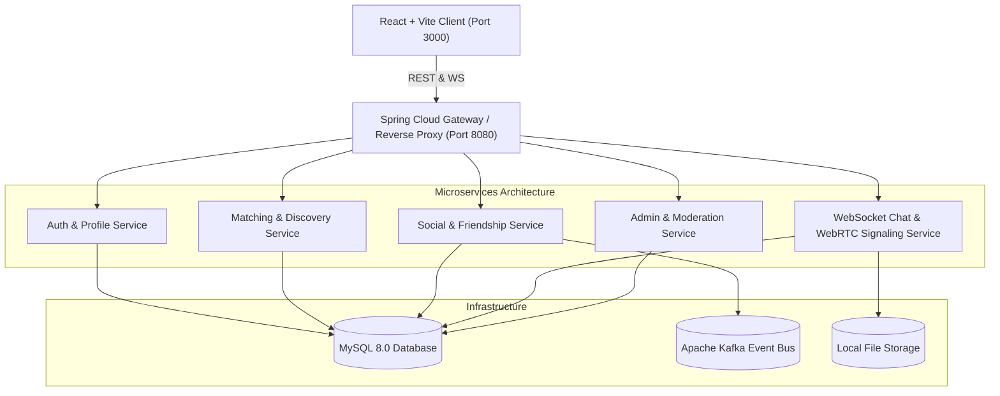

# 🔮 VibeMatch — Premium Full-Stack Social Networking Platform

> **Find Your Frequency.** A next-generation social discovery and networking web platform featuring a glowing dark-mode glassmorphic UI, dynamic particle background animations, quantum interest matching algorithms, WhatsApp-grade real-time messaging, and peer-to-peer WebRTC audio/video calls.

---

## 🌌 Tech Stack & Architecture

### **Frontend**
- **Framework**: React 18, Vite, TypeScript
- **Styling**: Tailwind CSS (custom dark theme, glowing purple/cyan neon accents, glassmorphism utilities)
- **Particles**: `@tsparticles/react` & `@tsparticles/slim`
- **Icons**: `lucide-react`
- **Celebration Effects**: `canvas-confetti`
- **Real-Time Communication**: Native WebSocket client with STOMP message format and WebRTC P2P Data/Media channels

### **Backend**
- **Language & Runtime**: Java 17+ (JDK 17/21/25/26 compatible)
- **Framework**: Spring Boot 3.3.4 (REST API, WebSocket STOMP broker, Security 6, Data JPA, Validation)
- **Security**: JWT Authentication (HMAC-SHA256 via JJWT 0.12.5), BCrypt password hashing, stateless sessions, role-based authorization (`ROLE_USER`, `ROLE_ADMIN`)
- **Real-Time Engine**: Spring WebSocket & STOMP Message Broker (`/ws`, `/topic`, `/app`)
- **WebRTC Signaling**: In-app WebRTC SDP offer/answer and ICE candidate relay for 1-to-1 audio and video calls
- **Event Bus**: Apache Kafka producer / consumer integration for decoupled notifications
- **Database**: MySQL 8.0 (production / Docker) & H2 (zero-setup development profile)
- **Storage**: Pluggable `StorageService` (Local filesystem `./uploads` with extensible S3 / Cloud Object Storage provider)

---

## 🏛️ Architecture & Microservices



### Microservice Modules Directory:
- **`backend/vibematch-core`**: High-performance unified Spring Boot 3.3 core service combining gateway routing, domain controllers, security, WebSocket STOMP, and WebRTC signaling for instant local development and Docker deployment.
- **`backend/gateway-service`**: Standalone Spring Cloud Gateway microservice routing client requests to downstream microservices.
- **`backend/auth-service`**: Dedicated Authentication & User Profile microservice module.
- **`backend/match-service`**: Dedicated Neural & Jaccard Matching algorithm engine.
- **`backend/social-service`**: Friend request state machine, friendships, communities, and moderation.
- **`backend/chat-service`**: WebSocket STOMP real-time messaging, audio note storage, and WebRTC signaling.
- **`frontend/`**: Modern React 18 + Vite + TypeScript application with Tailwind CSS and tsparticles.
- **`docker/`**: Multi-container Docker Compose file (`docker-compose.yml`) and MySQL 8.0 schema initialization script (`init.sql`).

---

## ⚡ Core Features

1. **Authentication & Profile Customization**:
   - Secure JWT token authentication with bcrypt password hashing.
   - Comprehensive profile setup: Bio, Location, Age, Gender, Vibe Archetype, Interest tags, Hobbies, and Languages.
2. **Harmonic Resonance Matching Engine**:
   - Multi-factor algorithm:
     - 40% Shared Interests (Jaccard similarity index)
     - 25% Vibe Archetype Affinity (e.g. "Tech Alchemist" + "Cosmic Dreamer")
     - 20% Shared Hobbies
     - 15% Language overlap
     - Baseline harmony bonus
   - Dynamic compatibility verdicts (*"✨ Stellar Quantum Resonance"*, *"💜 High Harmonic Synergy"*).
   - Smart AI Icebreaker suggestions tailored to shared interests.
3. **Friend Requests & Relationship Management**:
   - Friend request state machine: Send, Accept, Reject, Withdraw.
   - Friends directory with real-time online presence and last message preview.
   - User blocking (bidirectional silencing) and Trust & Safety reporting.
4. **WhatsApp-Grade Real-Time Chat**:
   - WebSocket STOMP bidirectional messaging.
   - Text messages with double-tick read receipts (blue/cyan when read).
   - Audio Voice Note recorder & player with animated equalizer sound waves.
   - Image and media file attachments.
   - Live typing indicators ("*Maya is typing...*").
   - Emoji reactions (*💜, 🔥, ✨, 👏, 😂, 🚀*) attached to message bubbles.
   - 1-Click AI Icebreaker prompt auto-insertion.
5. **One-to-One Audio & Video Calling (WebRTC)**:
   - In-app incoming call overlay modal with audio/video ringing animation.
   - Direct browser P2P video streaming with local picture-in-picture stream.
   - Microphone mute/unmute, Camera on/off, Screen Sharing, and Call duration timer.
6. **Vibe Hub Communities**:
   - Curated spaces for subcultures (*"Neon Cyberpunks & Synth Heads"*, *"AI Builders & Neural Hackers"*, *"Cosmic Dreamers"*, *"Midnight Gamers"*).
   - Community feeds with post discussions and reactions.
7. **Admin Moderation Dashboard**:
   - Real-time platform KPI metrics (Total users, Online users, Matches made, Messages exchanged, Pending reports).
   - User directory with Verified badge toggle and Ban/Unban controls.
   - Flagged reports moderation queue with 1-click Resolve and Dismiss actions.
8. **Privacy Controls**:
   - **Ghost Mode**: Cloak location and presence from active discovery feeds.
   - Toggle Read Receipts (double blue checkmarks).
   - Toggle Online active status.
   - Public, Friends Only, or Private profile visibility scopes.

---

## 👥 Demo Accounts (Pre-Seeded)

The application comes pre-loaded with realistic, rich demo profiles. You can log into any of these accounts with 1-click from the login screen:

| Full Name | Username | Password | Role / Archetype | Interests |
| :--- | :--- | :--- | :--- | :--- |
| **Alex Rivera** | `alex_vibe` | `password123` | Tech Alchemist | Cyberpunk, AI Art, Synthwave, Tech, Coffee |
| **Maya Lin** | `maya_cosmic` | `password123` | Cosmic Dreamer | Ambient Music, Cyberpunk, Generative Art, Design |
| **Jordan Vance** | `jordan_cyber` | `password123` | Synthwave Producer | Synthwave, Retro Gaming, Sound Design, Analog Gear |
| **Chloe Taylor** | `chloe_pulse` | `password123` | Creative Polymath | Techno, Creative Coding, Philosophy, Sci-Fi |
| **Liam Chen** | `liam_zen` | `password123` | Night Owl Adventurer | Tech, Urban Exploring, Night Cycling, Indie Games |
| **Admin Moderator** | `admin` | `admin123` | System Administrator | Platform Trust, Safety & Operations |

---

## 🚀 Step-by-Step Run Instructions

### Option 1: Docker Compose (All-in-One Multi-Container Setup)

Run the entire platform (MySQL 8, Kafka, Zookeeper, Backend Service, Frontend Nginx):

```bash
cd docker
docker compose up --build
```

- **Frontend App**: [http://localhost:3000](http://localhost:3000)
- **Backend API**: [http://localhost:8080](http://localhost:8080)
- **MySQL Database**: `localhost:3306` (User: `vibematch`, Pass: `vibe_secret_123`, DB: `vibematch_db`)

---

### Option 2: Local Development (Fast Zero-Friction Setup)

The backend includes a zero-friction development profile that uses an embedded in-memory database with automatic demo data seeding.

#### 1. Start the Backend:
```bash
# In the project root:
export JAVA_HOME="/Library/Java/JavaVirtualMachines/jdk-26.jdk/Contents/Home" # or your local JDK path
./gradlew :backend:vibematch-core:bootRun
```
*The Spring Boot backend will start on `http://localhost:8080` and seed all demo users, chat messages, friendships, and communities.*

#### 2. Start the Frontend:
```bash
# In another terminal window:
cd frontend
npm run dev
```
*The Vite React development server will start on `http://localhost:3000` with automated proxying to the backend API and WebSocket endpoints.*

---

## 📡 REST API Reference

### Authentication
- `POST /api/auth/register` — Register a new user profile with archetype and interests
- `POST /api/auth/login` — Authenticate and receive JWT Bearer token
- `GET /api/auth/me` — Get authenticated user details
- `GET /api/auth/demo-accounts` — Get list of demo test accounts

### Matches & Discovery
- `POST /api/matches/discover` — Discover candidate profiles with custom filter criteria
- `GET /api/matches/{targetUserId}/compatibility` — Retrieve multi-factor match percentage and score breakdown

### Social & Friendships
- `GET /api/social/friends` — List confirmed friendships with last messages
- `GET /api/social/requests/incoming` — List received friend requests
- `GET /api/social/requests/outgoing` — List sent friend requests
- `POST /api/social/requests/send/{receiverId}` — Send friend request
- `POST /api/social/requests/{requestId}/accept` — Accept friend request
- `POST /api/social/requests/{requestId}/reject` — Reject friend request
- `POST /api/social/requests/{requestId}/withdraw` — Withdraw sent request
- `POST /api/social/block/{targetUserId}` — Block user
- `POST /api/social/unblock/{targetUserId}` — Unblock user
- `POST /api/social/report` — Submit moderation report

### Chat & Messaging
- `GET /api/chat/conversations` — Get active conversations with unread counts
- `GET /api/chat/messages/{otherUserId}` — Get message history with reactions
- `POST /api/chat/messages/send` — Send text, voice note, or media message
- `POST /api/chat/messages/reaction` — Add emoji reaction to message
- `POST /api/chat/messages/read/{senderId}` — Mark conversation as read
- `GET /api/chat/icebreakers/{targetUserId}` — Generate AI icebreakers
- `POST /api/chat/upload` — Upload media or voice audio file

### Communities
- `GET /api/communities` — List all interest-based communities
- `GET /api/communities/{id}` — Get community details
- `POST /api/communities/{id}/join` — Join community
- `POST /api/communities/{id}/leave` — Leave community
- `GET /api/communities/{id}/posts` — Get community feed posts
- `POST /api/communities/{id}/posts` — Create new feed post

### Admin Moderation
- `GET /api/admin/metrics` — Platform KPIs and analytics
- `GET /api/admin/users` — Directory of users
- `POST /api/admin/users/{id}/toggle-verify` — Toggle verified badge
- `POST /api/admin/users/{id}/toggle-ban` — Ban or unban user
- `GET /api/admin/reports` — Flagged user reports
- `POST /api/admin/reports/{id}/resolve` — Resolve or dismiss report

---

## 📞 WebSocket & WebRTC Signaling

Connect via STOMP to `/ws` with message broker destination `/topic`:

- **Messages**: Subscribe `/topic/messages/{userId}`
- **Typing Indicator**: Send `/app/chat.typing` -> Broadcast `/topic/typing/{receiverId}`
- **Reactions**: Send `/app/chat.reaction` -> Broadcast `/topic/reactions/{receiverId}`
- **Notifications**: Subscribe `/topic/notifications/{userId}`
- **WebRTC Call Signaling**: Send `/app/call.signal` -> Broadcast `/topic/calls/{receiverId}`
  - Signal Types: `CALL_REQUEST`, `CALL_ACCEPT`, `CALL_DECLINE`, `CALL_END`, `OFFER`, `ANSWER`, `ICE_CANDIDATE`

---

## 🛡️ License
Built with passion by Google DeepMind Advanced Agentic Coding Pair Programming.
